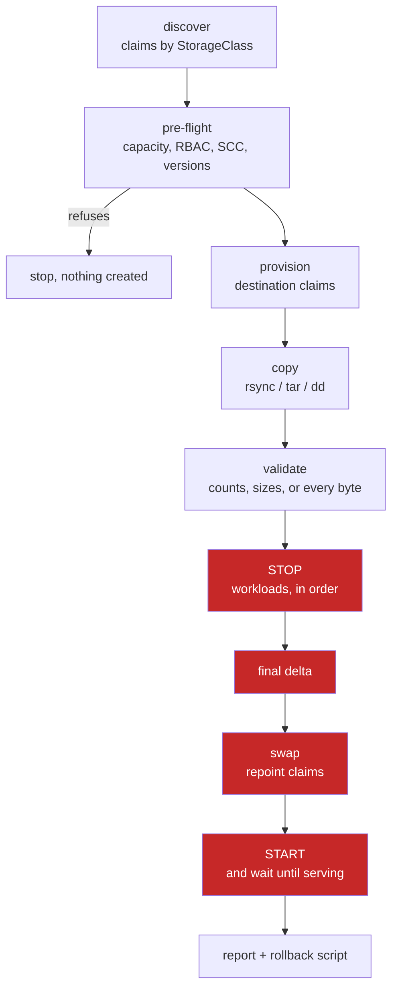
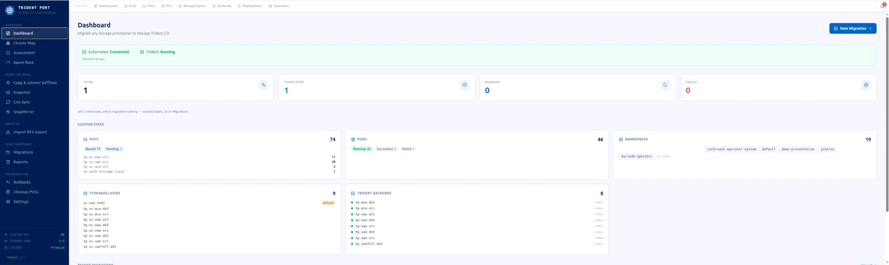
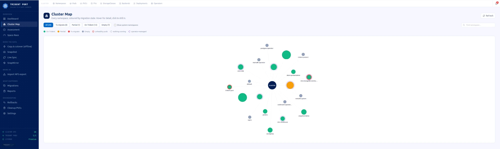
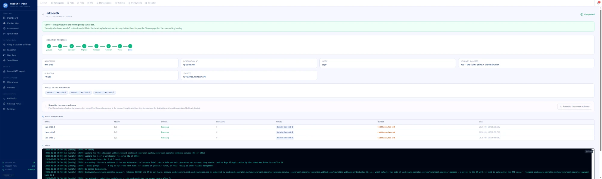
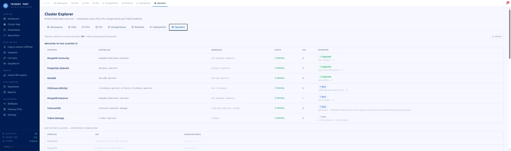

# Trident Port

> **Sailing to a Safe Harbor.** Move Kubernetes persistent volumes from any storage
> provisioner onto NetApp Trident CSI.

---

## What it is, and who it is for

Many Kubernetes clusters keep their data on storage that the team no longer wants to
run: an NFS server, Longhorn, Ceph, local disks, vSphere volumes. When the plan is to
standardise on NetApp, the question is always the same. How do you move the data
behind hundreds of volumes without losing any of it, and without an outage nobody
agreed to?

Trident Port answers that question. It copies the data behind each
`PersistentVolumeClaim` onto a volume provisioned by NetApp Trident, then points the
application at the new volume. It stops what holds the claim, in the right order, and
starts it again when the move is done.

It is written for the people who own the platform: infrastructure leads, storage
administrators and the architects who have to sign off a migration plan.

**Where it can read from:** NFS subdir, Longhorn, Rook/Ceph (RBD and CephFS),
local-path, OpenEBS, vSphere CSI, Portworx, hand-made volumes, and Trident itself.

**Where it can write to:** any Trident backend. That means `ontap-nas`,
`ontap-nas-economy`, `ontap-nas-flexgroup`, `ontap-san`, `ontap-san-economy`,
`azure-netapp-files` and FSx for ONTAP.

### What it guarantees

- **Your original volumes are not deleted.** Before anything else happens they are
  set to `Retain`, so they outlive their claims. Leftovers are listed for you to
  reclaim. Nothing is removed unless an operator asks for it.
- **You can go back.** Every run leaves a session record with its plan, a log per
  phase and a rollback script. One command returns the application to its original
  volume.
- **The stop time is announced as a ceiling.** Before a cutover the product tells
  you how long the application will be down, and that figure is meant to be an
  upper bound. In 4 of 4 measurements on a real cluster, covering cutovers and
  rollbacks, the announced figure covered the real stop.
- **It refuses rather than guesses.** If the pre-flight checks find a problem
  (capacity, permissions, versions, a namespace already being migrated), the run
  stops before anything is created.
- **It checks the result.** After the copy, source and destination are compared by
  file counts, sizes and modification times, or byte by byte if you ask for it.
  Raw block volumes are always compared across the whole device.

---

## What a migration looks like

A migration moves through six steps. You can pause between them, and every step
before the cutover happens while the application keeps running.

1. **Assess.** `tp survey` and the web Assessment page look at the cluster and say
   which volumes can move, by which method, and why. It is read-only. For anything
   it rules out, it states the exact reason, for example that the source driver
   registers no snapshot class.
2. **Plan.** `tp plan` shows what would happen to one namespace, method by method,
   with an estimate of the stop time based on this cluster's own measurements. A
   dry run (`--dry-run`) goes through discovery and pre-flight and creates, stops
   and copies nothing.
3. **Copy while the application runs.** The destination volumes are created and
   filled ahead of time. With the live methods, a separate copy pod does this and
   the application keeps serving.
4. **Cut over.** This is the only step that stops the application. The workloads
   are stopped in order, the last changes are copied, the claims are pointed at the
   new volumes, and the workloads are started again and watched until they serve.
5. **Validate.** The product compares source and destination and writes a report
   with the measured duration of every phase. It reads these durations from a
   permanent trace, so the report does not rest on an estimate.
6. **Go back, if needed.** `tp rollback --to-source` points the application at its
   original volume again. This is a reverse migration rather than an undo: data
   written to the new volume after the cutover stays there, and the product says so
   before it runs.



The four red stages are the cutover window. Everything before them runs with the
application up, whatever method you chose.

---

## Choosing how to move the data

The methods differ in how much of the copy happens before the application stops.
The planning engine evaluates all of them for your cluster, ranks what is available,
and gives the reason for anything it excludes.

| Application, from start to finish | |
|---|---|
| **Offline copy** | `████████████████████████` |
| **Snapshot** | `░░░░░░░░░░░░░░░░░░░░░░░█` |
| **Live sync** | `█░░░░░░░░░░░░░░░░░░░░░░█` |
| **SnapMirror** | `░░░░░░░░░░░░░░░░░░░░░░░█` |
| **Block cutover** | `█░░░░░░░░░░░░░░░░░░░░░░█` |

`░` the application is up and serving. `█` it is down.

| Method | Application stopped for | Touches the array | Needs |
|---|---|---|---|
| **Offline copy** (`copy`) | the full transfer | no | nothing beyond a destination claim |
| **Snapshot** (`snapshot`) | the final delta only | no | a `VolumeSnapshotClass` whose driver matches the source provisioner, and a filesystem volume |
| **Live sync** (`live-sync`) | the final cut, plus one restart at `start` for a ReadWriteOncePod volume | no, but it reads continuously from the source | Kubernetes 1.29+, a filesystem volume, and room to inject a sidecar |
| **SnapMirror** (`snapmirror`) | the break and the mount | yes, the transfer competes with production I/O on the same aggregates | ONTAP at both ends, cluster peering, credentials on both |
| **Block cutover** (`block-cutover`) | two brief windows (repoint, then switch), or the switch only without `start` and `cutover` | no, but a device-level resync runs on the node | a raw `Block` volume already on a node, and a destination claim |

Offline copy is always available and does the whole transfer inside the window. Block
cutover is never chosen automatically. An operator names it, and `tp mixed-cutover`
coordinates it with live sync when a namespace needs both. A given build may include
only some of these methods, and the product tells *"not included in this build"*
apart from *"your cluster cannot support this"*.

`tp import` is a separate case. It adopts an existing NFS export into a Trident claim
without copying it. The source is mounted read-only and never stopped.

<details>
<summary>SnapMirror in more detail</summary>

- SnapMirror addresses the economy storage classes (`ontap-nas-economy`,
  `ontap-san-economy`) and needs Trident **26.06+** (Tech Preview). Pre-flight checks
  the version, so a mismatch shows up before the cutover.
- SnapMirror works on a whole FlexVol, not on one claim. On the economy classes,
  several namespaces can share one FlexVol and the array does its delta, break and
  resize once for all of them. `--plan-only` shows which namespaces share one.
- Three cutover shapes handle shared FlexVols:
  - `together` cuts the whole FlexVol in one operation. Every namespace sharing it
    must be named, and `--with-flexvol-neighbours` adds a neighbour.
  - `waves` cuts one namespace per window. The cost is fragmentation: a qtree cannot
    move between FlexVols, so each wave copies the FlexVol again in full.
  - `clonedWaves` avoids that cost. It makes one baseline transfer, and each wave then
    cuts over its own FlexClone, with fewer source snapshots kept.

</details>

---

## What has been measured on real clusters

Everything here ran on a real cluster with a real ONTAP, and the result was checked
afterwards. The work took place in 2026, on RKE, RKE2, k3s,
OpenShift and vSphere clusters. Changes made after release 1.2.12 are not covered.

**Live sync across many namespaces.** On OpenShift, 2 of 2 namespaces synced with
their applications running, and a 3-claim cutover left a file modified after the sync
identical on both sides. A window of 10 namespaces migrated 10 of 10. On a k3s cluster
with vSphere CSI, a bulk start covered 14 namespaces with the applications running
(Argo CD, RabbitMQ, Keycloak and 10 StatefulSets), and 9 of them were cut over in one
bulk cutover with labels and annotations unchanged. On RKE with a virtual ONTAP, 3
namespaces were cut over in 2 windows and one was rolled back. Checksums, owner and
mode were identical for 203 of 203 entries in each namespace, and the applications
served after the cut and after the rollback.

**Snapshot plus live sync together.** Namespaces with the `baseline`, `restricted` and
`privileged` security levels all passed, with the rollback, modes and checksums
identical.

**Block cutover to a SAN class.** A Longhorn volume moved to a SAN class from the
command line (start, status, cutover and rollback) and a 32 MiB test file had the same
md5 on both sides.

**Security-restricted clusters.** On OpenShift the product binds its own security
context constraint for the copy pods and returns it when the run ends. Copy and batch
runs passed in a `restricted` namespace on OpenShift 4.21, with copy pods running
without root and a destination the application's group can write to. On a node with
SELinux enforcing (RKE on RHEL 9.6) a bulk live sync reached ready with 100 % copied
and no `Permission denied`, where the earlier build had failed.

**Edge cases that were run.**
- Namespaces with 63-character names: cutover and rollback both left identical data.
- A volume that belongs to someone else (an `Available` volume) was refused and
  nothing was copied.
- A first copy of 46 GiB in 19 files ran at 60 MiB/s with a progress bar and
  estimated time. A first copy of 150,001 small files (2.6 GB) took 12m24s, with a
  cutover of 67 s.
- Copy pod size matters. A 4 GiB test reached about 112 MiB/s with 2 CPU, against
  about 56 MiB/s at 500m.
- A restricted namespace holding a `lost+found` directory cut over in 1m37s against
  about 1m40s estimated, with identical md5.
- With `--copy-xattrs`, an extended attribute set on the source was read on the new
  volume.
- A StatefulSet that deletes its own claims (the official Loki chart, with `Delete`
  on both retention fields) migrated cleanly. The policy went to `Retain` before the
  stop, the claim stayed, the policy went back to `Delete` afterwards, and 2000 log
  lines kept the same checksum. The rollback did the same cycle.
- ThanosRuler in OpenShift's user-workload monitoring was stopped through the Cluster
  Monitoring Operator and cut in 2m35s. The StatefulSet came back 2 of 2 on NFS with
  its rules and alert kept. That cutover was run once and not repeated.

**Rollback.** On RKE, `tp rollback --to-source` acted on the right session among
several, a recreated namespace started a new session, and a source and destination on
the same backend were refused. Claim metadata was identical in both directions, with
the copier stopped first and nothing left in `Terminating`. A mixed session (a Strimzi
pool and a normal application in one namespace) was returned by one command, with 5000
messages and the application checksum identical.

**Applications that were slow to come back.** `tp auto --resume`,
`tp live-sync cutover`, `tp combo-cutover`, `tp mixed-cutover cutover`,
`tp snapmirror --resume` and the web Continue button all ended with exit code 9 and
the session `COMPLETED_NOT_READY` when the migration was done but the application was
only slow to start. `tp block-cutover` was not run for this case.

**Installation.** An RKE2 v1.32 cluster built from scratch with the operator
answered on the web interface and the API, and a read-only bulk plan changed nothing.
The operator install is also validated on k3s. After `helm uninstall` no cutover lease
was left behind. One upgraded release ran with no errors, with the API token read from
the Secret only (200 with it, 401 without).

**Speed analysis.** The measurement of storage speed ran from the command line and
from the web, with one saved result for both. On a cluster with about 20 StorageClasses
the run after install stops at 10 minutes and leaves most of them unmeasured.

**The web documentation page.** `/docs` loaded the interactive API reference in a
browser on OpenShift.

**Not measured.** Flux is not supported (Argo CD is). The rollback of the
Elasticsearch and Kafka native routes was not run. Operator kinds that are not in the
validated list below have not been run end to end.

---

## Applications that have an operator

A database or message broker managed by an operator cannot simply be scaled to zero.
The operator would bring it back, measured at under one second. Trident Port detects
the operator that owns each workload and stops and restores it through the operator's
own Custom Resource. The registry knows **44 kinds**, among them PostgreSQL, MongoDB,
MySQL and MariaDB, Kafka, Elasticsearch, OpenSearch, Redis, Valkey, Cassandra,
ScyllaDB, CockroachDB, TiDB, ClickHouse, Couchbase, MinIO, etcd, RabbitMQ, Prometheus,
Alertmanager, ThanosRuler and KubeVirt virtual machines.

The replica count is read and recorded before anything is scaled down. The order of
trust is an annotation left by an earlier run, then the Custom Resource's own spec,
then a default of 1. The annotation comes first because an interrupted run can leave
the spec at zero, and restoring that value would report success for a namespace that
never returns to service.

An operator that serves other namespaces is never suspended without your say-so.
`--hold-operator` is your acknowledgement that nothing reconciles there during the
window.

An unknown Custom Resource that offers a scale subresource is scaled generically, and
the product says so. Anything else stops with a warning instead of a blind scale.

There are four ways to stop an operator-managed workload.

1. **Native pause** through a dedicated field of the Custom Resource, such as
   `spec.offline` or `spec.stop`.
2. **Operator hold.** The operator's Deployment goes to 0 and the StatefulSet is
   scaled directly. This is used when the Custom Resource refuses `replicas: 0`,
   which 13 of the 44 kinds do, and it requires `--hold-operator`.
3. **Zero through the Custom Resource.** The replica field of the resource is
   patched and the operator scales itself down.
4. **Orphan and keep the volume.** The owner is deleted with the volume already set to
   `Retain`. Today this is used for KubeVirt.

### Elasticsearch and Kafka have their own routes

Elasticsearch on ECK refuses a change of storage class on a running claim, and
Strimzi keeps applying the pool's old class after a swap. For these two, the product
does not swap volumes. Each has its own command, with `plan` and `status`.

| Workload | Command | Route | Measured |
|---|---|---|---|
| Elasticsearch (ECK) | `tp eck-nodeset` | New node sets on the destination class, old ones retired once the cluster is ready. Old volumes are set to `Retain` first | Elasticsearch Ready after the move, no outage |
| Kafka brokers (Strimzi) | `tp strimzi-pool` | A new `KafkaNodePool` on the destination class. Partitions move by Cruise Control or Kafka's own reassignment, then the old pool is removed | Kafka Ready |
| Kafka controllers (Strimzi) | `tp strimzi-stopped` | Kafka paused, the same nodes copied to the destination class and swapped, then resumed | Kafka Ready, stopped or with `--live-sync` |

Both were run on OpenShift. In a namespace with other claims, these claims take their
route and the rest follow the chosen method in the same run.

### Operators validated end to end

Each of these was run from stop to restart on a real cluster. The mechanism numbers
refer to the four ways above, and `generic` means the unknown-operator path.

| Kind | Mechanism | Kind | Mechanism |
|---|---|---|---|
| `Artifactory` | generic | `Milvus` | 3 |
| `CouchDB` | generic | `MySQLCluster` (MOCO) | 1 |
| `CrdbCluster` (CockroachDB) | 2 | `MysqlCluster` (Presslabs) | 3 |
| `Dragonfly` | 3 | `NATS` | generic |
| `Gitea` | generic | `Neo4j` | generic |
| `Harbor` | generic | `PerconaServerMongoDB` | 3 |
| `MariaDB` | 3 | `PerconaXtraDBCluster` | 3 |
| `RabbitmqCluster` | 3 | `Seaweed` | 2 |
| `TemporalCluster` | 2 | `VirtualMachine` (KubeVirt) | 4 |
| `VMCluster` | 1 | `postgresql` (Zalando) | 3 |

That is 20 kinds, plus the two native routes above, 22 validated paths in all.

Two kinds are excluded on purpose. `CephCluster` (Rook) is storage infrastructure,
like Trident itself, and is not a migration target. `Vault` is excluded because
moving its Raft store underneath it is a correctness risk. The storage copy itself
completed cleanly on real hardware, but Vault's seal state still needs its own unseal
procedure, so a clean copy alone does not give a working handoff.

A few notes on specific kinds:

- A KubeVirt `VirtualMachine` disk moves through a dedicated DataVolume swap
  (`tp compat kv-dv-swap.sh swap <ns> <vm> <datavolume> <target-pv> <target-sc>`),
  validated end to end including data integrity inside the guest.
- `MySQLCluster` (MOCO) is the case where mechanism 1 works as designed, with a
  dedicated `spec.offline` field and no replica count.
- `Milvus` and `TemporalCluster` keep their state in dependent services such as etcd
  and MinIO rather than in the patched component, so their own Custom Resource patch
  is not exercised in practice. The namespace migration through those services'
  volumes completed cleanly.
- `Gitea`, `CouchDB`, `Neo4j`, `NATS`, `Harbor` and `Artifactory` were validated
  through the generic path, with direct and stated scaling.

The other kinds in the registry have not been run end to end on a cluster, so they are
not claimed as validated. That includes `CassandraDatacenter` (its stop changed after
an earlier run and has not been measured since), `ThanosRuler` (cut once on OpenShift,
see above), `ClickHouseKeeperInstallation`, `OpenshiftArtifactoryHa`, `Keycloak`,
`NexusRepo`, `Hazelcast` and `ActiveMQArtemis`.

---

## Argo CD and Git

If Argo CD manages a namespace, it would put the old StorageClass back as soon as
the claims moved. Trident Port suspends the Application for you when it has automated
sync, moves the claims and prints a session id. Git still names the old class until
you change it.

1. Run the migration. The run suspends the Application itself.
2. `tp gitops status --session <id>` lists what is left to change in Git.
3. `tp gitops bundle --session <id> --out <dir>` writes the change and an `apply.py`
   that you run inside your own clone, with your own credentials. Then commit, push
   and merge as you normally do. This is the path for private repositories. For a
   repository readable without a credential, `tp gitops apply --session <id> >
   change.patch` produces the same change as a patch for `git am`.
4. `tp gitops sync --session <id>` prints the Argo CD sync command. Add `--yes` to
   run it.
5. `tp gitops resume --session <id> --yes` gives the Application back its automated
   sync policy.

Trident Port never writes to your repository. The Application stays suspended until
you resume it.

What the change touches: only the line that holds the old StorageClass. It edits a
Helm `values.yaml` key, a Kustomize file or a plain YAML manifest, and only when
exactly one place matches. When it cannot (an Application with several sources or a
config-management plugin, a layout it does not recognise, or several matching values)
the change is listed as `unknown`, nothing is edited, and you make it by hand.

For a StatefulSet, `tp gitops sts-vct --session <id> --yes` recreates it with its
`volumeClaimTemplates` on the new class, and pods and claims stay. For several
namespaces, `--namespaces a b c` replaces `--session`, and
`tp gitops bundle --all --out <dir>` writes one change per repository. An Application
generated by an ApplicationSet is named with its ApplicationSet, and the change goes
into the ApplicationSet's own source. The same steps are in the web interface, under
the migration's **Git change** tab and in **Bulk**.

**What was measured.** On OpenShift (October 2026) and on k3s with vSphere CSI
(October 2026), against a real Argo CD: status, change package, merge, StatefulSet
recreation, sync and resume. The Application was suspended during the migration, the
Git change edited only `storageClassName`, and the StatefulSet was recreated by Argo
CD with its claim template on the new class, Synced and Healthy. An ApplicationSet
child with 10 StatefulSets went through with the pods not restarted. For an
app-of-apps, `tp gitops resume --yes` restored child and parent, and a second `resume`
ended with exit code 0 and `Nothing to resume`. Rolling back an application with
`selfHeal` is refused with exit code 3 before anything is stopped, and with
`--allow-gitops` it suspends and reverts. Argo Workflows was run on RKE2 too: a cutover
in 55 s, 3 completed Workflow pods deleted before the swap, the CronWorkflow restored
and identical md5.

If Argo CD runs in a different cluster from the one being migrated, the product needs
that hub's kubeconfig. The install guides cover it.

---

## What survives a cutover

Every **label** on the source claim is carried to the new claim, unfiltered. There is
no list of supported annotations to keep up to date. Backup labels, GitOps tracking
ids, KubeVirt markers and cost-centre labels all survive.

Three families of **annotations** are dropped, because they describe the old binding
and would be wrong on the new one.

| Dropped | Why |
|---|---|
| `pv.kubernetes.io/*`, `volume.kubernetes.io/*`, `volume.beta.kubernetes.io/*` | Written by the binding machinery. The API server writes its own on the new claim |
| `trident.netapp.io/*` | Trident's record of an earlier SnapMirror import. It is true of the volume just imported onto and false of the one being migrated to |
| `kubectl.kubernetes.io/last-applied-configuration` | Describes the object as declared before the migration. A later `kubectl apply` would compare against a spec that no longer exists |

Each dropped annotation is named in the migration report, so a design decision cannot
be mistaken for data loss.

---

## Installation

You do not need to know Kubernetes internals to follow the guides, but you need
someone with administrator access to the cluster. Trident Port is installed by an
operator, which is a small program that sets up and looks after the product for you.

### What NetApp gives you first

Nobody can download Trident Port without being given access. Your NetApp contact
provides two things.

- **A download link and a download token.** They fetch the installation file.
- **A read token for the image registry (`ghcr.io`).** The online path uses it to pull
  the images.

You also need a **licence** for your cluster (see below). The guides say exactly
when each one is used.

### Pick a path

| Path | Choose it when | What you receive |
|---|---|---|
| **Online** | The cluster nodes can pull images from `ghcr.io`. | `trident-port-operator-<version>.tar.gz`, plus the read token for `ghcr.io` |
| **Offline** | The cluster cannot reach the internet. The images go into your own registry (Harbor or similar). | `trident-port-offline-<version>.tar.gz` and its `.sha256` file (about 360 MB), holding the three images, `install.yaml`, examples, `load-images.sh` and the guides |

Follow the guide for your path. Every block in them can be pasted as it is, and you
edit your own values once, at the start.

- [`docs/INSTALL-OPERATOR-ONLINE.md`](docs/INSTALL-OPERATOR-ONLINE.md)
- [`docs/INSTALL-OPERATOR-OFFLINE.md`](docs/INSTALL-OPERATOR-OFFLINE.md)

The current release is **v1.2.12**.

### What your cluster needs

- Kubernetes 1.25 or later (1.29 or later for live sync), and `cluster-admin` for the
  install. It creates a CRD, a ClusterRole and a ClusterRoleBinding.
- Trident 24 or later, running with an online backend. Trident 26.06 or later is
  needed to import qtrees in SnapMirror mode.
- The destination StorageClass or StorageClasses on Trident, created by you. Trident
  Port only selects them.
- A StorageClass for the product's own tracking volume (2 GiB). It must have reclaim
  policy `Retain` and must not be a class you will migrate from. A Trident NAS class
  is recommended.
- A Kubernetes Secret holding the ONTAP credentials, and at least one
  `TridentBackendConfig` in the `Bound` state for the destination class.
- Room on one node for the product pod, which requests 250m CPU and 512 Mi and is
  limited to 4 CPU and 2 Gi. During a migration, each volume being copied adds a copy
  pod that requests 50m and 64 Mi.
- A browser that can reach a node IP, because the web interface is a NodePort service.

For the offline path you also need a private project in your own registry (about
370 MB), a user that can push to it and pull from it, and a host that reaches both the
registry and the cluster, with `kubectl`, `skopeo` (or `docker`), `sha256sum`, `curl`
and `tar`.

To check the cluster side before you start:

```bash
kubectl version
kubectl get pods -A -l app=controller.csi.trident.netapp.io
kubectl get sc
```

### The steps, in short

Offline:

1. Verify the bundle (`sha256sum -c`) and extract it.
2. `load-images.sh` pushes the three images to your registry and checks every digest.
3. Create the namespace `trident-port-system` and the pull secret.
4. Apply `install.yaml`, pointed at your registry. This deploys the operator.
5. Create the product's pull secret and apply the `TridentPort` resource with your
   tracking class.
6. Apply the licence.
7. Check that no pod pulls from outside your registry.

Online is the same without steps 1, 2 and 7. The pull secret holds the `ghcr.io` read
token.

### Licence

You need one licence per cluster. It is issued for the cluster's serial number, which
is the UID of its `kube-system` namespace. You read it with:

```bash
kubectl get ns kube-system -o jsonpath='{.metadata.uid}{"\n"}'
```

The licence is issued for that value, so have it ready when you ask for yours. The product
installs and runs without a licence. Commands that move data refuse until one is
applied (in the web interface: Settings, License). Read-only planning and the disaster
recovery commands (`rollback`, `stand-down`) never need one.

### Upgrade

The upgrade step of the guide: load the new images, apply the new `install.yaml` (the operator
first), then patch the `TridentPort` image tag. Do not upgrade while a cutover is
running.

### Uninstall

```bash
kubectl -n trident-port delete tridentport trident-port
kubectl delete -f install.yaml
```

The tracking volume (`trident-port-tracking`) is kept on purpose, so session history
and rollback scripts survive a reinstall. Delete it yourself if you no longer need it.

---

## Where it runs

Trident Port has been run on RKE2, Red Hat OpenShift, k3s and RKE. Live sync needs
Kubernetes 1.29 or later because it uses native sidecar containers. On every other
point it follows the requirements above.

On the image pull: the copy pods run the Trident Port image inside the namespace being
migrated. The product copies its own pull secret into that namespace for the run and
removes it afterwards.

---

## The web interface

|  |  |
|---|---|
|  |  |
|  |  |
|  |  |
|  |  |
|  |  |

The web interface has a page for each step above and for each method. The main pages are these.

| Page | Path | What it is for |
|---|---|---|
| Dashboard | `/dashboard` | cluster overview, claim counts, configuration state |
| Assessment | `/assessment` | pre-flight and the migration plan, on one screen |
| Cluster Map | `/cluster-map` | every namespace as a node, coloured by state, with operators overlaid |
| New Migration | `/migrations/new` | the guided wizard |
| Auto Migration | `/auto-migration` | a whole namespace in one launch |
| Batch Migration | `/batch-migration` | several namespaces, one after another or in parallel against a live capacity ceiling |
| Space Race | `/space` | projects whether the source will fill before the baseline completes |
| Cutover | `/cutover` | the swap, as a separate operation |
| Snapshot, Live Sync, SnapMirror, Block Cutover | `/snapshot-migration` `/live-sync` `/snapmirror` `/block-cutover` | one page per method |
| Import NFS | `/import-nfs` | adopt an external export |
| Sessions | `/sessions` | every run, live or finished |
| Migrations and Reports | `/history` `/reports` | history, one row per volume |
| Rollbacks | `/rollbacks` | the way back, per session |
| Cluster Explorer | `/cluster` | namespaces, pods, claims, volumes, StorageClasses, backends |
| Cleanup | `/cleanup` | source claims and orphaned Released volumes |
| Settings | `/settings` | configuration, connection tests, permissions, licence |

---

## Command reference

The `tp` commands run inside the Trident Port pod. From your own machine:
`kubectl -n trident-port exec -it deploy/trident-port -c trident-port -- tp <command>`
(use `oc` instead of `kubectl` on OpenShift).

Reading, planning and the disaster-recovery commands are always unlocked. Commands
that move or change data need a valid licence.

**No licence required**

| Command | What it does |
|---|---|
| `tp survey` | assesses whether a cluster is eligible for migration. Read-only, and it dry-runs a copy pod's admission |
| `tp plan` | reports what would happen to one namespace's claims, method by method |
| `tp space` | projects whether the source volume fills before a baseline completes, sampled over time |
| `tp validate` | compares source and destination, and writes nothing |
| `tp sessions` | lists migrations on this installation, or follows one in progress |
| `tp report` | reports what happened to a namespace's volumes, matching the web view |
| `tp array-leftovers` | lists array volumes no longer referenced by the cluster. It explains and does not delete |
| `tp pre-engagement` | produces the read-mostly assessment kit for a discovery engagement |
| `tp rollback` | restores reclaim policies, and lists or removes leftovers |
| `tp start` | restores application availability after a stopped run |
| `tp support-bundle` | collects a complete diagnostic bundle |
| `tp stand-down` | scales this deployment to zero if a licence lapses |

**Licensed**

| Command | What it does |
|---|---|
| `tp auto` | migrates a whole namespace in one coordinated stop: discover, pre-flight, copy, validate, cut over, verify |
| `tp migrate` | migrates a single volume |
| `tp batch` | migrates several namespaces in sequence, each to its own destination |
| `tp snapshot` | copies from a clone while the application stays online (`bulk`), then cuts over (`cutover`) |
| `tp live-sync` | `start`, `status`, `stop`, `cutover` |
| `tp snapmirror` | replicates FlexVols between arrays and adopts their contents |
| `tp import` | brings a foreign NFS export into a Trident claim |
| `tp cutover` | repoints claims to the new volumes |
| `tp stop` | stops the workloads holding the claims |
| `tp block-cutover` | mirrors a Block volume's device to its destination and switches. `start` and `cutover` also repoint the application's own claim onto it |
| `tp mixed-cutover` | `start` and `cutover` for a namespace that mixes live sync and block volumes |
| `tp combo-cutover` | one shared cutover window for two or more of snapshot, block mirror and live sync in the same namespace |

### One namespace, end to end

```bash
# Rehearsal: discovery and pre-flight only. Nothing is created, stopped or copied.
tp auto --namespace shop --dest-sc ontap-nas --dry-run

# Execute: one coordinated stop, every claim in the namespace.
tp auto --namespace shop --dest-sc ontap-nas

# Multiple source classes in one namespace: a destination per source class.
tp auto --namespace shop --dest-sc ontap-nas --sc-map "longhorn=ontap-nas,ceph-rbd=ontap-san"

# Copy and validate only, leaving applications in place.
tp auto --namespace shop --dest-sc ontap-nas --exclude cache-0 --no-cutover
```

Four parameters control how much runs at once during the cutover window. Each
defaults to full concurrency except adoption.

| Flag | Governs | Default |
|---|---|---|
| `--copy-parallel` | the copy: a Job, a pod and an image pull per volume | all |
| `--stop-parallel` | stopping workloads, within each ordering tier | all |
| `--start-parallel` | restoring workloads, which are already down, so higher concurrency adds no risk | all |
| `--adopt-parallel` | `tridentctl import` concurrency | **1** |

`--bwlimit` caps the read rate in rsync's own notation (`20M`, `200K`) and is the only
throttling control.

### The other methods

```bash
# Snapshot: copy from a clone with the application online, then take the delta.
tp snapshot bulk    --namespace shop --pvc data-0 data-1 --dest-sc ontap-nas
tp snapshot cutover --namespace shop --pvc data-0 data-1

# Live sync: a sidecar keeps the destination current. The cut is the final delta.
tp live-sync start   --namespace shop --pvc data-0 --dest-sc ontap-nas
tp live-sync cutover --namespace shop --pvc data-0 --dest-sc ontap-nas

# SnapMirror, ONTAP to ONTAP. Plan first. The baseline runs with the application online.
tp snapmirror --namespaces shop --dest-svm svm_new --plan-only
tp snapmirror --namespaces shop --dest-svm svm_new --cutover-only

# Block cutover: mirrors a raw Block device, then repoints the claim onto it.
tp block-cutover start   --namespace shop --pvc data-0 --dest-sc ontap-san
tp block-cutover cutover --namespace shop --resume <session-id>

# Adopt an existing NFS export. The source is mounted read-only.
tp import --namespace shop --server 10.0.0.5 --path /exports/archive \
  --claim archive --dest-sc ontap-nas --size 500Gi
```

### Validation and rollback

`tp validate` compares counts, sizes and effective modification times by default.
`--mode full` (or `strict`) reads every byte on both sides. Raw block volumes are
always compared across the full device, because a matching start of the device only
shows nothing has differed so far and does not confirm a match. A formatted block
destination's `lost+found` and Trident's own `.snapshot` and `trident_pvc_*` paths
are left out on purpose.

Every run leaves a session under `tracking/sessions/<id>` with its plan, its
per-phase log and a rollback script.

```bash
tp sessions
tp sessions --session sess-8a21 --follow
tp rollback --namespace shop                                    # restores reclaim policies, lists leftovers
tp rollback --namespace shop --to-source --session sess-8a21 --yes
```

`--to-source` is a reverse migration, not an undo. It points the application back at
its original volume, and data written to the destination since the cutover stays
there. The product states this before it runs.

---

## Safeguards

- **Infrastructure namespaces are protected.** Stopping workloads in a namespace that
  runs storage infrastructure removes volumes instead of quieting them, so
  `--i-know-this-is-infrastructure` is required to proceed.
- **GitOps is detected.** An Argo CD Application with automated sync is suspended by
  the run and handed back with `tp gitops resume`. When it cannot be suspended (Flux,
  an Application without automated sync, or one that cannot be read) the operation is
  declined, naming the owning resource and the exact suspend command.
  `--allow-gitops` goes ahead without suspending anything, and then the controller can
  recreate a claim on the source class while it is being swapped.
- **One run per namespace.** A second run against a namespace already in flight is
  refused and not queued. `tp auto`, `tp batch`, `tp snapmirror` and `tp live-sync`
  all go through the same guard:

  ```
  [ERROR] a migration of 'shop' is already running: shop-20260911-101500
    (started …, phase 'copy'). Two concurrent runs on one namespace would
    read volumes the first run is actively restoring.
  ```

- **A dry run changes nothing.** This is enforced inside the engine, and any change of
  state during a rehearsal is treated as a defect.
- **A long copy is never silent.** Progress is reported at a fixed interval, with
  elapsed time and the exact command to follow the live log. rsync cannot give a
  reliable estimate, so you get intervals instead of a percentage.
- **Trident's controller may restart once during a SnapMirror import.** When an import
  is refused because a volume name is still held in memory, Trident restarts its own
  controller. This happens at most once per run, and only after a refused import.
  `--no-trident-restart` turns it off and stops the cutover at the first refused
  import, with remediation steps.

---

## Security and permissions

- **The image is compiled.** It carries no product source and no shell tooling beyond
  what the product itself runs.
- **Permissions are narrow.** One `ClusterRole` gives read access to core objects
  including `secrets` (get, list and watch, never write, which is how the product
  reaches the ONTAP credentials without a copy in every namespace), create and delete
  on `batch/jobs` and `pods`, patch on `deployments`, `statefulsets`, `daemonsets` and
  `replicasets`, and scoped access to each supported operator's own resource group.
  There is no wildcard over custom resources.
- **The copy pod is not privileged.** It runs as root with
  `allowPrivilegeEscalation: false` and no added capabilities, which is enough to keep
  file ownership and to write a raw block device. It is not asked to be `privileged`,
  which OpenShift's `restricted-v2` policy rejects by design. Exactly one path needs an
  extra capability: mounting a foreign NFS export, which needs `CAP_SYS_ADMIN`. In a
  namespace that enforces `PodSecurity: restricted`, the copy pods run without root,
  with the namespace's own user and group.
- **On OpenShift nothing is granted by hand.** The product binds its own security
  context constraint to the copy service account before the copy pods start, and
  returns it when the run ends, or keeps it while copy pods are still running. This
  was measured on OpenShift for `tp live-sync` (bulk), `tp strimzi-stopped`,
  `tp migrate` and `tp auto`. If the chart's constraint is not installed, or the
  product may not create a RoleBinding in that namespace, it prints the exact command
  for you to run.
- **The interface is authenticated.** The default Service is `ClusterIP`. Every
  request except health checks, static assets and the activation screen must carry an
  `X-Trident-Port-Token` header, which is generated at install time and checked in
  constant time.
- **The licence is bound to one cluster.** It is tied to the UID of the cluster's
  `kube-system` namespace, so a copied token does not work elsewhere.
- **Everything is auditable.** `/metrics` exposes migration counts, licence status and
  audit counters in Prometheus format. `tracking/trace.jsonl` is an append-only record
  of the command line and the web interface, including every refusal, in a form that
  can be loaded into a SIEM. Each session folder also keeps its plan and per-phase
  logs, and `tp support-bundle` gathers them.

---

## Before a migration window

Confirm these ahead of time, so they are not discovered during the window.

- **Permissions.** The chart installs the RBAC. On OpenShift nothing else is needed.
- **A `VolumeSnapshotClass`** registered for the source provisioner, if you intend to
  use the snapshot method. Without it the planner excludes that method.
- **The destination `TridentBackendConfig` in `Bound` state.**
- **ONTAP credentials** in a Kubernetes Secret the product can read.
- **A pull secret.** The product handles this itself, as described above.

How long the window lasts depends on the method. Offline copy puts the whole transfer
inside it, so it grows with the size of the data. Snapshot and live sync take the bulk
transfer out and leave the final delta. SnapMirror cuts by FlexVol, not by claim. The
pre-flight and the plan estimate the window for each namespace from this cluster's own
measurements, and the speed analysis (Settings, or `tp speed-analyze`) measures your
storage. For sizing against a specific data set, ask your Trident Port contact for an
assessment.

A migration counts as successful when `tp validate` agrees with a byte-level
comparison, the report shows every cutover phase with a measured duration, and a
complete session record exists under `tracking/sessions/<id>/`.

---

## Support

- `tp support-bundle` produces a diagnostic archive with logs, trace and session
  state to send to support.
- Before you contact support, capture the active session
  (`tp sessions --session <id> --follow`) and the exact error text.
- Contact your Trident Port contact or supporting partner for the support channel of
  your engagement.

---

## Licence

Trident Port is commercial software.
Copyright © 2026 Carlos Alzaga. All rights reserved.

Licensing: [github.com/trident-port](https://github.com/trident-port)

---

*Trident Port. Sailing to a Safe Harbor.*
