# Trident Port

> **Sailing to a Safe Harbor.** Move Kubernetes persistent volumes from any storage
> provisioner onto NetApp Trident CSI.

---

## Architecture & Capabilities

Trident Port moves the data behind a `PersistentVolumeClaim` onto a
Trident-provisioned volume, then repoints the application at it, stopping what
holds the claim, in the correct order, and restoring it once the cutover completes.

**Source:** any provisioner: NFS subdir, Longhorn, Rook/Ceph (RBD and CephFS),
local-path, OpenEBS, vSphere CSI, Portworx, hand-made PVs, and Trident itself.

**Destination:** any Trident backend: `ontap-nas`, `ontap-nas-economy`,
`ontap-nas-flexgroup`, `ontap-san`, `ontap-san-economy`, `azure-netapp-files`,
FSx for ONTAP.

### How Long the Application Stops

The destination volume is created and filled ahead of time, and the application is
moved onto it in a planned, bounded window. The methods differ in how much of the copy
happens before that window:

| Method | The application, from start to finish |
|---|---|
| **Offline copy** | `████████████████████████` |
| **Snapshot** | `░░░░░░░░░░░░░░░░░░░░░░░█` |
| **Live sync** | `█░░░░░░░░░░░░░░░░░░░░░░█` |
| **SnapMirror** | `░░░░░░░░░░░░░░░░░░░░░░░█` |
| **Block cutover** (`start`/`cutover`) | `█░░░░░░░░░░░░░░░░░░░░░░█` |

`░` the application is up and serving · `█` it is down

Offline copy does the whole transfer inside the cutover window. The other methods do
it before the window, and each needs something in return (see the table below). Live
sync usually copies from a separate pod with the application running. A
ReadWriteOncePod volume needs one restart at `start` to add a sidecar. Block cutover
has two short windows: one to repoint the application onto the mirror, one to switch
when the resync is done.

---

## The Methods

| Method | Application stopped for | Touches the array | Requires |
|---|---|---|---|
| **Offline copy** (`copy`) | the full transfer | no | nothing beyond a destination claim |
| **Snapshot** (`snapshot`) | the final delta only | no | a `VolumeSnapshotClass` whose driver matches the source provisioner, and a filesystem volume |
| **Live sync** (`live-sync`) | the final cut (plus one restart at `start` for a ReadWriteOncePod volume) | no, but a continuous read on the source | Kubernetes 1.29+, a filesystem volume, and room to inject a sidecar |
| **SnapMirror** (`snapmirror`) | the break and the mount | yes: the transfer competes with production I/O on the same aggregates | ONTAP at both ends, cluster peering, credentials on both |
| **Block cutover** (`block-cutover`) | two brief windows (repoint, then switch) or the switch only, without `start`/`cutover` | no, but a device-level resync on the node | a raw `Block` volume already on a node, and a destination claim |

`tp import` adopts an existing NFS export into a Trident claim without copying it:
the source is mounted read-only and never stopped.

The planning engine evaluates every method for the target environment, ranking what
is available and stating, for anything excluded, the precise reason: *"snapshot is
unavailable because the source CSI driver does not register a VolumeSnapshotClass."*

**Design considerations:**

- **SnapMirror addresses the economy storage class** (`ontap-nas-economy`,
  `ontap-san-economy`). Requires Trident **26.06+** (Tech Preview); pre-flight
  validates the version rather than failing at cutover.
- **SnapMirror operates at the FlexVol level, not the individual claim.** On
  `ontap-*-economy`, several namespaces may share a single FlexVol, and the array
  performs its delta, break and resize **once per FlexVol**. `--plan-only` identifies
  which namespaces share a FlexVol.
- **Three cutover shapes govern how shared FlexVols are handled:**
  - **`together`** cuts the entire FlexVol in one operation. Every namespace sharing
    it must be named, `--with-flexvol-neighbours` folds a neighbour in.
  - **`waves`** cuts one namespace per window, at the cost of fragmenting the
    estate, a qtree cannot move between FlexVols, so each wave re-copies the
    FlexVol in full.
  - **`clonedWaves`** avoids fragmentation cost: one baseline transfer, then each
    wave cuts over its own FlexClone, a single transfer instead of N, with reduced
    source-side snapshot retention.
- **A given build may include a subset of these methods.** *"Not included in this
  build"* is distinct from *"the target cluster cannot support this."* Offline copy
  is always available.
- **Block cutover is never selected automatically**: the only method above that the
  planning engine skips; an operator names it directly. `tp mixed-cutover` coordinates
  it with Live Sync when both are needed in the same namespace.

---

## What a Run Does

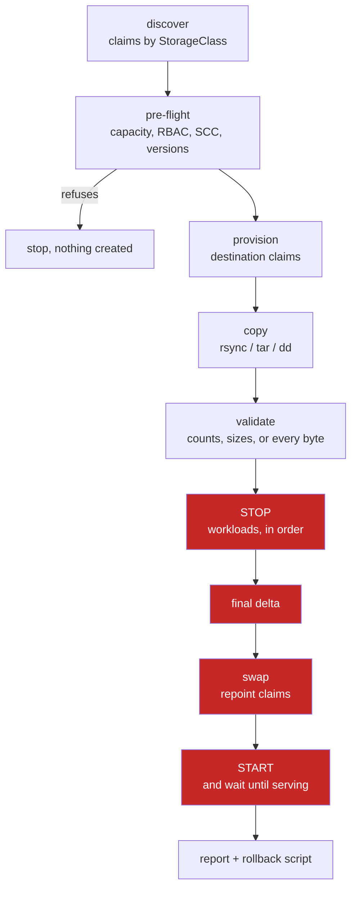

**The four highlighted stages are the cutover window.** Everything preceding them
executes with the application running, regardless of method. Every phase records its
own duration to a permanent trace, and reporting reads that record rather than
asserting an estimate.

**Source volumes are never deleted.** They are set to `Retain` before anything else
happens, so they persist beyond their claims. Leftover volumes are surfaced for
reclamation; nothing is removed without an explicit operator action.

---

## Supported and Validated Environments

Trident Port is validated against the following platforms:

- **RKE2**
- **Red Hat OpenShift**
- **K3s**
- **Upstream Kubernetes 1.29+** (1.29+ required for live sync's native sidecar support)

| | |
|---|---|
| Kubernetes | any distribution Trident supports · **1.29+** for live sync |
| NetApp Trident | 24+ · **26.06+** for qtree import in SnapMirror mode |
| Trident backend | at least one `TridentBackendConfig` bound, provisioning into the destination StorageClass |
| Credentials | a Kubernetes Secret holding the ONTAP credentials |
| Registry | offline: your own registry; online: `ghcr.io` with a read token. The product copies its pull secret into each namespace it migrates, for the run only |
| Licence | a token bound to the cluster's `kube-system` namespace UID |

---

## Measured on Real Clusters

Everything listed here ran against a real cluster and a real ONTAP, with the result
checked afterwards. Dates are 2026. Rows from October ran on lab builds made during
the 1.2.x work. Not measured:
KubeVirt, Flux (not supported; Argo CD is) and the rollback of the Elasticsearch
and Strimzi native routes.

| Area | Where | Result |
|---|---|---|
| Install through the operator | RKE2 v1.32, built from scratch with the operator (14 Oct) | Web interface and API answer; a read-only bulk plan (`tp live-sync start --namespaces`) runs and changes nothing. The operator install is also validated on k3s |
| Live sync, many namespaces | OpenShift (13 Oct) | `2 of 2 namespace(s) syncing with the applications running`; cutover of 3 claims, a file modified after the sync identical on both sides |
| Live sync, window of 10 namespaces | OpenShift (9 Oct) | 10 of 10 namespaces migrated |
| vSphere CSI source to ONTAP NAS | k3s (14 Oct) | Live-sync cutover: stop, final delta, swap and restart; application serving after the cut |
| Argo CD (real instance) | OpenShift (13 and 14 Oct) | Application suspended during the migration; Git change delivered as a patch; sync policy restored by `tp gitops resume`; StatefulSet recreated with its claim template on the new class |
| Elasticsearch on ECK | OpenShift (13 Oct) | Moved through new node sets with no outage; Elasticsearch Ready |
| Kafka on Strimzi | OpenShift (13 Oct) | Broker pool moved through a new pool, Kafka Ready; controller pool moved with Kafka stopped, or with live sync, Kafka Ready |
| OpenShift security context constraint | OpenShift (13 and 14 Oct) | The product binds its own SCC for the copy pods and returns it when the run ends |
| Live sync of several namespaces with the cutover in windows | RKE with a virtual ONTAP (18 Oct) | 3 namespaces with the applications running, cut over in 2 windows, one namespace rolled back. sha256, owner and mode identical in 203 of 203 entries per namespace; the applications serve after the cut and after the rollback |
| Copy pods on a node with SELinux Enforcing | RKE on RHEL 9.6 (18 Oct) | Bulk live sync in a `restricted` namespace reached READY with 100 % copied and no `Permission denied`; the previous build failed with `Permission denied` |
| Namespaces with 63-character names | RKE with a virtual ONTAP (19 Oct) | Live-sync cutover with identical sha256 and modes, rollback with identical data; 0 illegal label values out of 16 checked |
| Snapshot plus live sync (combo) | RKE with a virtual ONTAP (18 Oct) | `baseline`, `restricted` and `privileged` namespaces pass; the report reads `2 of 2`; rollback, modes and sha256 identical. |
| Block cutover (SAN) | RKE with a virtual ONTAP (18 Oct) | Longhorn to a SAN class from the command line: start, status, cutover and rollback, md5 of 32 MiB identical |
| Argo CD app-of-apps | RKE (18 Oct) | `tp gitops resume --yes` restores child and parent; a second `resume` ends rc 0 with `Nothing to resume`. A rollback of an application with `selfHeal` is refused (rc 3) before anything is stopped; with `--allow-gitops` it suspends and reverts |
| Rollback and session handling | RKE (18 Oct) | `tp rollback --to-source` acts on the session that holds the destination with 3 `ROLLED_BACK` and 1 `COMPLETED` sessions; a recreated namespace starts a new session; source and destination on the same backend are refused |
| Previous modes | RKE with a virtual ONTAP (18 Oct) | Copy rc 0 with md5 intact; live-sync start and cutover pass |
| Uninstall | RKE (18 Oct) | No cutover Lease left after `helm uninstall` |
| Extended attributes | OpenShift (13 and 14 Oct) | With `--copy-xattrs`, a `user.*` attribute set on the source is read on the new volume (`tp live-sync`, `tp migrate`, `tp auto`) |
| vSphere CSI to ONTAP NAS, bulk live sync | k3s with vSphere CSI (28 and 29 Oct) | Bulk start over 14 namespaces with the applications running (Argo CD, RabbitMQ, Keycloak, 10 StatefulSets); 9 namespaces cut over in one bulk cutover, labels and annotations unchanged |
| Argo CD after the cutover | k3s with vSphere CSI (29 Oct) | Git change from the package, StatefulSet recreated by Argo CD, sync and resume; same pods, same volumes. Also an ApplicationSet child with 10 StatefulSets |
| Restricted namespace (OpenShift) | OpenShift 4.21 (28 Oct) | Copy and batch by command line pass in a `restricted` namespace: copy pods without root, destination writable by the application's group |

---

## Installation

Trident Port is installed by its operator. There are two paths, and they end in the same place:

| Path | When | What you receive |
|---|---|---|
| **Offline** | The cluster cannot reach the internet. Images go into your own registry (Harbor or similar). | `trident-port-offline-<version>.tar.gz` and its `.sha256` (about 360 MB): the three images, `install.yaml`, examples, `load-images.sh` and the guides |
| **Online** | The nodes can pull from `ghcr.io`. | `trident-port-operator-<version>.tar.gz`, and a read token for `ghcr.io` |

The step-by-step guides ship inside those files and are also here:
[`docs/INSTALL-OPERATOR-OFFLINE.md`](docs/INSTALL-OPERATOR-OFFLINE.md) and
[`docs/INSTALL-OPERATOR-ONLINE.md`](docs/INSTALL-OPERATOR-ONLINE.md). Every block in
them can be pasted as it is. You edit your own values once, at the start.

Current release: **v1.2.3**.

### Before you start

Per cluster:

- Kubernetes 1.25 or later, and `cluster-admin` for the install. It creates a CRD, a ClusterRole and a ClusterRoleBinding.
- Trident 24 or later running, with an online backend.
- The destination StorageClass(es) on Trident, created by you. Trident Port only selects them.
- A StorageClass for the tracking volume (2 GiB). It must have reclaim policy `Retain` and must not be a class you will migrate from. A Trident NAS class is recommended.
- Room on one node for the product pod: it requests 250m CPU / 512 Mi and is limited to 4 CPU / 2 Gi. During a migration, each volume being copied adds a copy pod (request 50m / 64 Mi).
- A browser that reaches a node IP: the web UI is a NodePort service.

Once, for the offline path:

- A private project in your registry (about 370 MB) and a user that can push to it and pull from it.
- A host that reaches the registry and the cluster, with `kubectl`, `skopeo` (or `docker`), `sha256sum`, `curl` and `tar`.

Check the cluster side:

```bash
kubectl version
kubectl get pods -A -l app=controller.csi.trident.netapp.io
kubectl get sc
```

### The steps, in short

Offline:

1. Verify the bundle (`sha256sum -c`) and extract it.
2. `load-images.sh` pushes the three images to your registry and checks every digest.
3. Create the namespace `trident-port-system` and the pull secret.
4. Apply `install.yaml`, pointed at your registry. This deploys the operator.
5. Create the product's pull secret and apply the `TridentPort` resource with your tracking class.
6. Apply the licence.
7. Check that no pod pulls from outside your registry.

Online: the same without steps 1, 2 and 7. The pull secret holds the `ghcr.io` read token.

### Licence

One licence per cluster, issued for the cluster's serial number, which is the UID of the `kube-system` namespace:

```bash
kubectl get ns kube-system -o jsonpath='{.metadata.uid}{"\n"}'
```

The product installs and runs without a licence. Commands that move data refuse until one is applied (web: Settings, License).

### Upgrade

Step 13 of the guide: load the new images, apply the new `install.yaml` (operator first), then patch the `TridentPort` image tag. Do not upgrade while a cutover is running.

### Uninstall

```bash
kubectl -n trident-port delete tridentport trident-port
kubectl delete -f install.yaml
```

The tracking volume (`trident-port-tracking`) is kept on purpose, so session history and rollback scripts survive a reinstall. Delete it yourself if you no longer need it.

---

## Image and Permissions

The delivered image is compiled. It carries no product source and no shell tooling
beyond what the product itself runs.

**RBAC is namespace-agnostic, and scoped to exactly what each operation needs**
(a single `ClusterRole`): read access on core objects including `secrets` (get/list/watch, **never write**: this is how the
product reaches ONTAP credentials without requiring a copy per namespace),
create/delete on `batch/jobs` and `pods`, patch on
`deployments`/`statefulsets`/`daemonsets`/`replicasets`, and scoped access on each
supported operator's own CRD group, never a wildcard over custom resources.

**The copy workload is not a privileged container.** It runs as root
(`runAsUser: 0`) with `allowPrivilegeEscalation: false` and no additional
capabilities, sufficient to preserve filesystem ownership and write a raw block
device. Requesting `privileged` access is unnecessary and is rejected under
OpenShift's `restricted-v2` policy by design. Exactly one code path requires an additional
capability: mounting a foreign NFS export, which requires `CAP_SYS_ADMIN`.

**On OpenShift the product binds its own security context constraint** (installed
by the Helm chart) to the copy service account, in each namespace, before the copy
pods start, and returns it when the run ends, or keeps it while copy pods are still
running. Measured on OpenShift for `tp live-sync` (bulk), `tp strimzi-stopped`,
`tp migrate` and `tp auto`. Nothing has to be granted by hand. Only if the chart's
SCC is not installed, or the product may not create a RoleBinding in that namespace,
does the product print the manual command to run (plan B).

**Trident's own controller may be restarted as part of a SnapMirror import**: shared
CSI infrastructure, restarted by Trident itself, not by this product directly, when
an import is refused while a volume name is still held in memory. This occurs **at
most once per run, and only when an import was actually refused**; `--no-trident-restart`
disables this behavior, stopping the cutover at the first refused import with
remediation steps provided.

**Interface access is authenticated and scoped to a single deployment.** The default
Service is `ClusterIP`; the API runs with the deployment's own RBAC, so an
`X-Trident-Port-Token` header (generated and persisted at install time, validated in
constant time) is required on every request except health checks, static assets and
the activation screen.

**Licence entitlement is bound to the target cluster's identity** (its `kube-system`
namespace UID) and does not transfer if the token is copied to another cluster.
Completed migrations are recorded in a signed usage ledger (HMAC), protecting the
integrity of the usage count independent of the cluster operator.

**Every operation is auditable.** `/metrics` exposes Prometheus-format migration
counts, licence status and audit counters; `tracking/trace.jsonl` is an append-only,
SIEM-ready record of the CLI and web interface, including every refusal.

---

## Command Reference

**Licensing model**: read-only planning (`survey`, `plan`) and critical disaster
recovery operations (`rollback`, `stand-down`) are permanently unlocked and do not
require an active licence entitlement. Operations that migrate or mutate data require
a validated licence.

**Reading and planning, no licence required**

| Command | What it does |
|---|---|
| `tp survey` | assesses whether a cluster is eligible for migration; read-only, dry-runs a copy pod's admission |
| `tp plan` | reports what would happen to one namespace's claims, method by method |
| `tp space` | projects whether the source volume fills before a baseline completes; sampled over time |
| `tp validate` | compares source and destination; performs no writes |
| `tp sessions` | lists migrations on this installation, or follows one in progress |
| `tp report` | reports what happened to a namespace's volumes, matching the interface's view |
| `tp array-leftovers` | lists array volumes no longer referenced by the cluster; explains, does not delete |
| `tp pre-engagement` | produces the read-mostly assessment kit for a discovery engagement |
| `tp rollback` | restores reclaim policies, lists or removes leftovers |
| `tp start` | restores application availability after a stopped run |
| `tp support-bundle` | collects a complete diagnostic bundle |
| `tp stand-down` | scales this deployment to zero if a licence lapses |

**Data operations, licensed**

| Command | What it does |
|---|---|
| `tp auto` | migrates a whole namespace in one coordinated stop: discover, pre-flight, copy, validate, cut over, verify |
| `tp migrate` | migrates a single volume |
| `tp batch` | migrates several namespaces in sequence, each to its own destination |
| `tp snapshot` | copies from a clone while the application remains online (`bulk`), then cuts over (`cutover`) |
| `tp live-sync` | `start`, `status`, `stop`, `cutover` |
| `tp snapmirror` | replicates FlexVols between arrays and adopts their contents |
| `tp import` | brings a foreign NFS export into a Trident claim |
| `tp cutover` | repoints claims to the new volumes |
| `tp stop` | stops the workloads holding the claims |
| `tp block-cutover` | mirrors a Block PVC's device to its destination and switches; `start`/`cutover` also repoint the application's own claim onto it |
| `tp mixed-cutover` | `start`/`cutover`, the same repoint as `live-sync` and `block-cutover`, coordinated for both mixed in one namespace |
| `tp combo-cutover` | one shared cutover window for two or more of snapshot, block mirror and live sync in the same namespace |

### A Namespace, End to End

The `tp` commands below run inside the Trident Port pod. From your machine:
`kubectl -n trident-port exec -it deploy/trident-port -c trident-port -- tp <command>`
(`oc` instead of `kubectl` on OpenShift).

```bash
# Rehearsal: discovery and pre-flight only. Nothing is created, stopped or copied.
tp auto --namespace shop --dest-sc ontap-nas --dry-run

# Execute: one coordinated stop, every claim in the namespace.
tp auto --namespace shop --dest-sc ontap-nas

# Multiple source classes in one namespace: a destination per source class.
tp auto --namespace shop --dest-sc ontap-nas --sc-map "longhorn=ontap-nas,ceph-rbd=ontap-san"

# Copy and validate only, leaving applications in place.
tp auto --namespace shop --dest-sc ontap-nas --exclude cache-0 --no-cutover
```

**Four parameters govern the cutover window**, each defaulting to full concurrency
except adoption:

| Flag | Governs | Default |
|---|---|---|
| `--copy-parallel` | the copy, a Job, a pod and an image pull per volume | all |
| `--stop-parallel` | stopping workloads, within each ordering tier | all |
| `--start-parallel` | restoring workloads, already down, so higher concurrency introduces no additional risk | all |
| `--adopt-parallel` | `tridentctl import` concurrency | **1** |

`--bwlimit` caps the read rate in rsync's own notation (`20M`, `200K`) and is the
only throttling control.

### The Other Methods

```bash
# Snapshot: copy from a clone with the application online, then take the delta.
tp snapshot bulk    --namespace shop --pvc data-0 data-1 --dest-sc ontap-nas
tp snapshot cutover --namespace shop --pvc data-0 data-1

# Live sync: a sidecar keeps the destination current; the cut is the final delta.
tp live-sync start   --namespace shop --pvc data-0 --dest-sc ontap-nas
tp live-sync cutover --namespace shop --pvc data-0 --dest-sc ontap-nas

# SnapMirror, ONTAP to ONTAP. Plan first; the baseline runs with the application online.
tp snapmirror --namespaces shop --dest-svm svm_new --plan-only
tp snapmirror --namespaces shop --dest-svm svm_new --cutover-only

# Block cutover: mirrors a raw Block device, then repoints the claim onto it.
tp block-cutover start   --namespace shop --pvc data-0 --dest-sc ontap-san
tp block-cutover cutover --namespace shop --resume <session-id>

# Adopt an existing NFS export. The source is mounted read-only.
tp import --namespace shop --server 10.0.0.5 --path /exports/archive \
  --claim archive --dest-sc ontap-nas --size 500Gi
```

### Validation and Rollback

`tp validate` compares counts, sizes and effective modification times by default;
`--mode full` (or `strict`) reads every byte on both sides. **Raw block volumes are
always compared across the full device**: a matching prefix is the absence of
counter-evidence, not confirmation of a match. Excluded by design: a formatted block
destination's `lost+found`, and Trident's own `.snapshot`/`trident_pvc_*` paths.

Every run leaves a session under `tracking/sessions/<id>` with its plan, its
per-phase log and a rollback script.

```bash
tp sessions
tp sessions --session sess-8a21 --follow
tp rollback --namespace shop                                    # restores reclaim policies, lists leftovers
tp rollback --namespace shop --to-source --session sess-8a21 --yes
```

**`--to-source` is a reverse migration, not an undo.** It repoints the application to
its original volume; data written to the destination since cutover remains there.
This is stated explicitly before the operation executes.

---

## The Web Interface

|  |  |
|---|---|
| 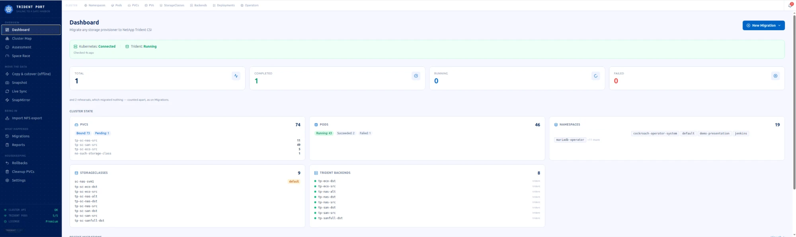 | 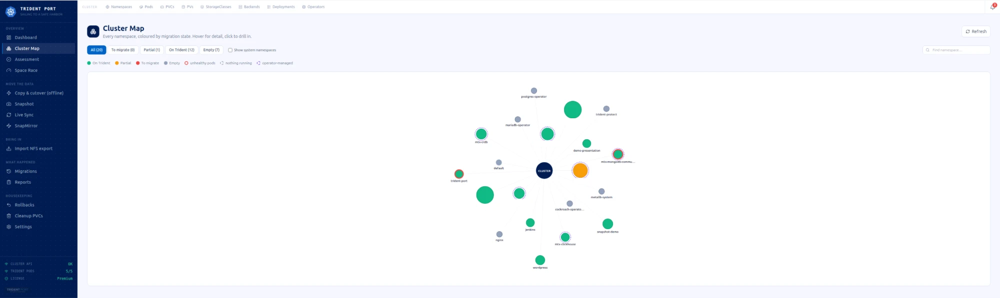 |
| 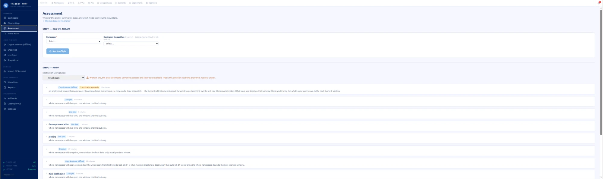 | 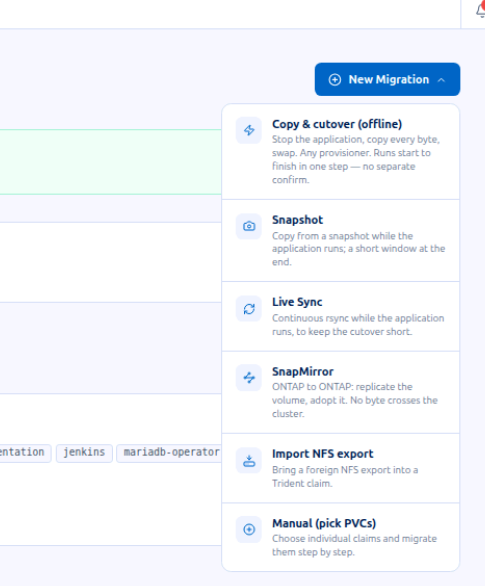 |
| 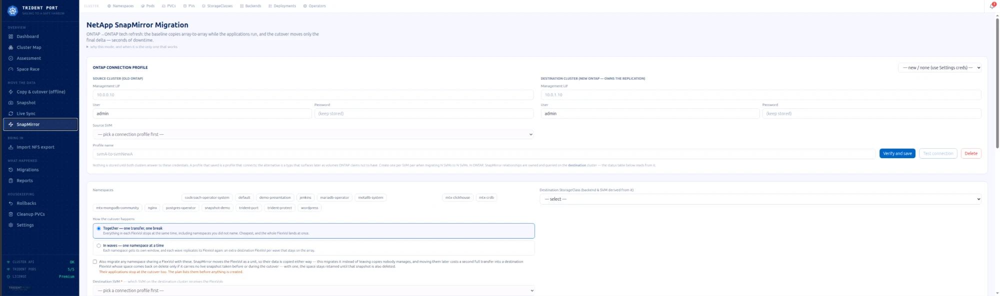 | 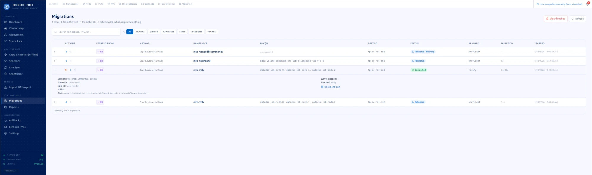 |
| 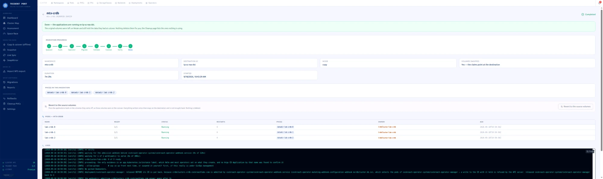 | 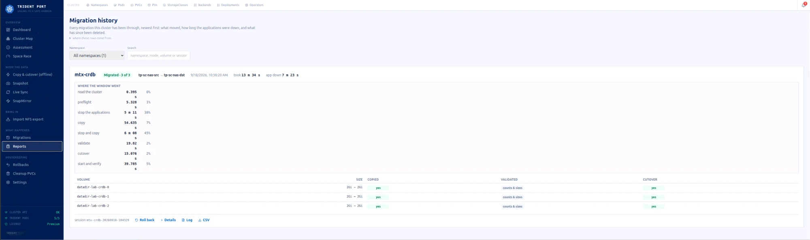 |
| 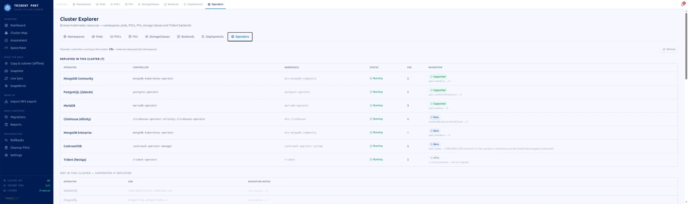 | 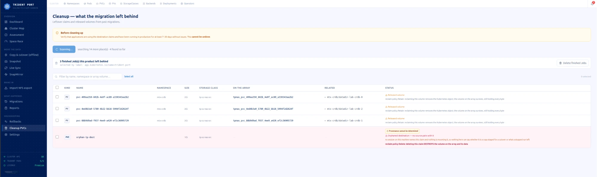 |

| Page | Path | Purpose |
|---|---|---|
| Dashboard | `/dashboard` | cluster overview, claim counts, configuration state |
| Assessment | `/assessment` | pre-flight and the migration plan, on one screen |
| Cluster Map | `/cluster-map` | every namespace as a node, coloured by state, with operator overlay |
| New Migration | `/migrations/new` | the guided migration wizard |
| Auto Migration | `/auto-migration` | a whole namespace in one launch |
| Batch Migration | `/batch-migration` | multiple namespaces, sequential or parallel against a live capacity ceiling |
| Space Race | `/space` | projects whether the source will fill before the baseline completes |
| Cutover | `/cutover` | the swap, as an isolated operation |
| Snapshot · Live Sync · SnapMirror · Block Cutover | `/snapshot-migration` `/live-sync` `/snapmirror` `/block-cutover` | one page per method |
| Import NFS | `/import-nfs` | adopt an external export |
| Sessions | `/sessions` | every run, live or finished |
| Migrations · Reports | `/history` `/reports` | migration history, one row per volume |
| Rollbacks | `/rollbacks` | the undo path, per session |
| Cluster Explorer | `/cluster` | namespaces, pods, claims, volumes, StorageClasses, backends |
| Cleanup | `/cleanup` | source claims and orphaned Released volumes |
| Settings | `/settings` | configuration, connection testing, permissions, licence |

---

## Applications With an Operator

A StatefulSet owned by an operator must be stopped **through its Custom Resource**,
or the operator restores it automatically, measured at under one second. Detection
is by `ownerReferences` and CR name; the registry covers **40 kinds** (PostgreSQL,
MongoDB, MySQL/MariaDB, Kafka, Elasticsearch, OpenSearch, Redis, Valkey, Cassandra,
ScyllaDB, CockroachDB, TiDB, ClickHouse, Couchbase, MinIO, etcd, RabbitMQ,
Prometheus and others).

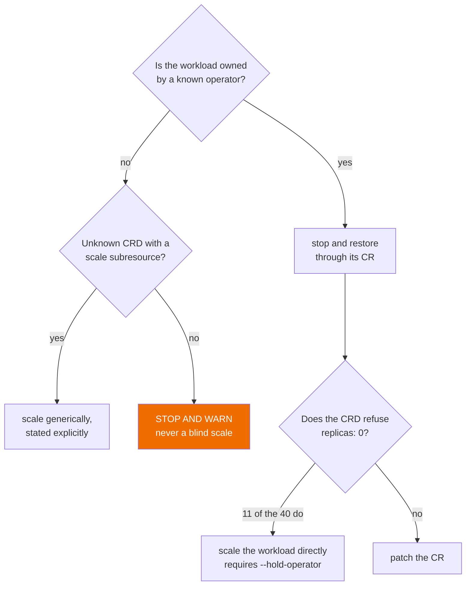

**The replica count is read and recorded before any scale-down occurs**, in order: an
annotation from a prior run, then the CR's own spec, then a default of 1. The
annotation takes precedence because an interrupted run can leave the spec itself at
zero, and restoring that value would report success against a namespace that never
returns to service.

An operator serving *other* namespaces is never suspended without explicit
authorization: `--hold-operator` is an operator-level acknowledgment that nothing
reconciles there for the duration of the window.

### The Four Cutover Mechanisms for Operator-Managed Workloads

1. **Native pause, by CR**: a dedicated pause field (`spec.offline`, `spec.stop`).
2. **Operator hold**: the operator's Deployment to 0, StatefulSet scaled directly.
3. **Zero, by CR**: patches the CR's own replica field; the operator scales itself down.
4. **Orphan + PV Retain**: deletes the owner, with the PV already set to `Retain`.
   Available today for KubeVirt.

### Elasticsearch (ECK) and Kafka (Strimzi): Native Routes

ECK refuses a change of storage class on a running claim, and Strimzi keeps applying
the pool's old class to its claims after a swap. For both, the volume swap is not
used; each has its own route, online for Elasticsearch and Kafka brokers.

| Workload | Command | Route | Measured |
|---|---|---|---|
| Elasticsearch (ECK) | `tp eck-nodeset` | new node sets on the destination class, old ones retired once the cluster is ready; old volumes set to `Retain` first | Elasticsearch Ready after the move, no outage |
| Kafka brokers (Strimzi) | `tp strimzi-pool` | a new `KafkaNodePool` on the destination class; partitions move by Cruise Control or by Kafka's own reassignment, then the old pool is removed | Kafka Ready |
| Kafka controllers (Strimzi) | `tp strimzi-stopped` | Kafka paused, same nodes copied to the destination class and swapped, then resumed | Kafka Ready, stopped or with `--live-sync` |

In a namespace that also holds other claims, these claims take their route and the
rest follow the chosen mode in the same run. Each command has `plan` and `status`.

### Validated Compatibility, by Operator Kind

Every migration path is measured end to end against a real cluster before it is
published as supported. `✅` denotes a validated, production-ready path; `Native route · measured` marks a kind moved by
its own route (see [Native Routes](#elasticsearch-eck-and-kafka-strimzi-native-routes)),
measured on a real cluster; `excluded` marks a deliberate scope decision.

Each entry lists the mechanism applied (1–4 above, or `generic` for kinds without a
dedicated CRD path) alongside its validation status.

| Kind | Mechanism · Status | Kind | Mechanism · Status |
|---|---|---|---|
| `Artifactory` | generic · ✅ | `CassandraDatacenter` | 2 · ✅ |
| `CephCluster` (Rook) | excluded | `CouchDB` | generic · ✅ |
| `CrdbCluster` (CockroachDB) | 2 · ✅ | `Dragonfly` | 3 · ✅ |
| `Elasticsearch` | Native route · measured | `Gitea` | generic · ✅ |
| `Harbor` | generic · ✅ | `KafkaNodePool` | Native route · measured |
| `MariaDB` | 3 · ✅ | `Milvus` | 3 · ✅ |
| `MySQLCluster` (MOCO) | 1 · ✅ | `MysqlCluster` (Presslabs) | 3 · ✅ |
| `NATS` | generic · ✅ | `Neo4j` | generic · ✅ |
| `PerconaServerMongoDB` | 3 · ✅ | `PerconaXtraDBCluster` | 3 · ✅ |
| `RabbitmqCluster` | 3 · ✅ | `Seaweed` | 2 · ✅ |
| `TemporalCluster` | 2 · ✅ | `Vault` | excluded |
| `VirtualMachine` (KubeVirt) | 4 · ✅ | `VMCluster` | 1 · ✅ |
| `postgresql` (Zalando) | 3 · ✅ |  |  |

**23 validated paths: 21 production-ready, plus 2 native routes**, each measured clean end to end against a
real cluster.

`VirtualMachine`'s disk migrates through its own dedicated DataVolume swap
(`tp compat kv-dv-swap.sh swap <ns> <vm> <datavolume> <target-pv> <target-sc>`),
mechanism 4's shape rather than a CR patch, validated end to end, including data
integrity inside the guest. `MySQLCluster` (MOCO) is the validated case of mechanism 1
working exactly as designed: a dedicated `spec.offline` field, not a replica count.
`Gitea`, `CouchDB`, `Neo4j`, `NATS`, `Harbor` and `Artifactory` are validated through
the generic unknown-operator path (direct, stated scaling). `CephCluster` (Rook) is excluded by design: storage infrastructure, like
Trident itself, is not a migration target for this product. `Vault` is excluded by
design as well: migrating its Raft store underneath it is a correctness risk outside
the product's scope, validated against real hardware, the storage transfer itself
completes cleanly, but Vault's own seal state requires its native unseal procedure
regardless, so a clean storage copy alone does not constitute a working handoff.
`Milvus` (mechanism 3 entry) follows the same pattern as `TemporalCluster`: its own CR
patch is not exercised in practice because state resides in dependent services (etcd,
MinIO) rather than the patched component, the namespace migration itself, through
those dependencies' volumes, completes cleanly end to end.

---

## Operational Safeguards

- **Infrastructure namespaces** are protected by default; `--i-know-this-is-infrastructure`
  is required to proceed, stopping workloads in a namespace running storage
  infrastructure removes volumes rather than quiescing them.
- **A namespace under active GitOps reconciliation (Argo CD or Flux)** is detected.
  An Argo CD Application with automated sync is suspended by the run itself (its
  sync policy is saved in the session) and handed back with `tp gitops resume`; see
  [Argo CD and GitOps](#argo-cd-and-gitops). When it cannot be suspended, Flux, an
  Application without automated sync, or one that cannot be read, the operation is
  declined, naming the owning resource and the exact suspend command.
  `--allow-gitops` proceeds without suspending anything: the controller can then
  recreate a claim on the source class while it is being swapped.
- **A second run against a namespace already in flight is refused, not queued.**
  `tp auto`, `tp batch`, `tp snapmirror` and `tp live-sync` all route through a single
  session guard:

  ```
  [ERROR] a migration of 'shop' is already running: shop-20260911-101500
    (started …, phase 'copy'). Two concurrent runs on one namespace would
    read volumes the first run is actively restoring.
  ```

- **A dry run creates, stops or copies nothing**: enforced at the engine level.
- **A long-running copy is never silent.** Progress is reported on a fixed interval,
  with elapsed time and the exact command to follow the live log.

---

## Argo CD and GitOps

When a namespace is managed by Argo CD, `tp auto`, `tp combo-cutover` and `tp live-sync`
suspend its Application (when it has automated sync), move the claims and print a
session id. Git still names the old StorageClass until
it is changed.

1. Run the migration. The Application is suspended by the run itself.
2. `tp gitops status --session <id>` lists what is left to change in Git.
3. `tp gitops bundle --session <id> --out <dir>` writes the change and an `apply.py`
   that you run inside your own clone of the repository, with your own credentials;
   commit, push and merge it as usual. This is the path for private repositories.
   For a repository readable without a credential, `tp gitops apply --session <id> >
   change.patch` produces the same change as a patch for `git am`.
   - **What it changes:** only the line that holds the old StorageClass, with real
     paths. It edits a Helm `values.yaml` key, a Kustomize file or a plain YAML
     manifest, and only when exactly one place matches.
   - **When it cannot:** an Application with several sources or a config-management
     plugin, a layout it does not recognise, or several values that match. That
     change is listed as `unknown` and nothing is edited; make it by hand.
4. `tp gitops sync --session <id>` prints the Argo CD sync command; add `--yes` to run it.
5. `tp gitops resume --session <id> --yes` gives the Application back its automated
   sync policy.

For a StatefulSet, `tp gitops sts-vct --session <id> --yes` recreates it with its
`volumeClaimTemplates` on the new class (pods and claims stay); Argo CD recreated it
from Git, Synced and Healthy.

For several namespaces at once, `--namespaces a b c` replaces `--session`, and
`tp gitops bundle --all --out <dir>` writes one change per repository for every
suspended session. An Application generated by an ApplicationSet is named with its
ApplicationSet: the change goes in the ApplicationSet's own source. The same steps are
in the web interface under the migration's **Git change** tab and in **Bulk**.

Trident Port never writes to your repository. You run `apply.py` in your clone and push
with your own credential; the Application stays suspended until you resume it.

Measured against a real Argo CD on OpenShift (13 and 14 Oct 2026) and on vSphere CSI
with k3s (29 Oct 2026): status, change package, merge, StatefulSet recreation, sync and
resume. On 29 Oct this included an ApplicationSet child with 10 StatefulSets: the pods
were not restarted.

---

## What Survives a Cutover

**Label and annotation retention follows a deny-list, not an allow-list.**
Every label on the source claim carries to the replacement
unfiltered, there is no maintained list of "supported" annotations to extend as
tooling evolves. `backup.velero.io/backup-volumes`, `argocd.argoproj.io/tracking-id`,
`cdi.kubevirt.io/storage.populatedFor`, cost-centre labels: all are preserved.

**Three annotation families are dropped, each for a stated reason**: properties true
of the binding being replaced, and false of its replacement:

| Dropped | Rationale |
|---|---|
| `pv.kubernetes.io/*`, `volume.kubernetes.io/*`, `volume.beta.kubernetes.io/*` | written by the binding machinery; the API server writes its own on the new claim |
| `trident.netapp.io/*` | Trident's record of a prior SnapMirror import, true of the volume just imported onto, false of the one it is migrating to |
| `kubectl.kubernetes.io/last-applied-configuration` | describes the object as declared before the migration; a later `kubectl apply` would diff against a spec that no longer exists |

Every deliberately dropped annotation is named in the migration report, distinguishing
an intentional design decision from data loss.

---

## Observability

- **`/metrics`**: Prometheus text exposition: migration counts by status, licence
  validity, tier and limit, verified ledger entries, audit counters.
- **`tracking/trace.jsonl`**: append-only JSON lines, a unified record for the CLI
  and the web interface, including every refusal. Suitable for SIEM ingestion.
- **`tracking/sessions/<id>/`**: the plan, per-phase logs and trace for every run;
  the basis of a support bundle.

---

## Troubleshooting and Expected Results

| Situation | Observed Behavior | Resolution |
|---|---|---|
| A second run against a namespace already migrating | Refused: a migration of that namespace is already in progress | By design, concurrent runs on one namespace would overwrite each other's copy in progress. Wait for completion, or follow the active session |
| `tp auto` against an infrastructure namespace | Declined by default, requiring `--i-know-this-is-infrastructure` | Stopping workloads where storage itself runs can remove volumes rather than quiesce them. Requires explicit acknowledgment |
| A namespace under active Argo CD/Flux reconciliation | An Argo CD Application with automated sync is suspended by the run. Flux, an Application without automated sync, or one that cannot be read is declined, naming the owning resource and the exact suspend command | Suspend it as printed, or use `--allow-gitops` to proceed without suspending (the controller can recreate a claim on the source class during the swap) |
| `--dry-run` performs no changes | Enforced at the engine level | Any state change during a rehearsal is treated as a defect |
| A long-running copy shows no progress percentage | A status line is emitted on a fixed interval, with elapsed time and the exact command to follow the live log | rsync-based transfers cannot produce a reliable ETA; progress is reported by interval instead |

**A successful migration** is confirmed when `tp validate` agrees with the
byte-level checksum comparison, the migration report shows all cutover phases
with measured durations, and a complete session record exists under
`tracking/sessions/<id>/`, including its plan, per-phase log and rollback script.

---

## Support

- **`tp support-bundle`** produces a complete diagnostic archive (logs, trace,
  session state) for submission to support.
- Before contacting support, capture the active session (`tp sessions --session
  <id> --follow`) and the exact error text.
- Contact your Trident Port contact or supporting partner for engagement-specific
  support channels.

---

## Prerequisites and Best Practices

Beyond the environment requirements above, the following should be confirmed
ahead of a migration window rather than discovered during one:

- **RBAC**: installed by the chart. On OpenShift nothing else is needed: the product
  binds its own SCC (never `privileged`, which `restricted-v2` rejects by design).
  Plan B, only if the product prints that it could not bind it: run the command it
  prints. In a namespace that enforces `PodSecurity: restricted`, the copy pods run
  without root, with the namespace's own uid and group.
- **A `VolumeSnapshotClass` registered with a driver matching the source
  provisioner**, when the snapshot method is intended, the planning engine will
  otherwise exclude it, but resolving this ahead of time avoids a mid-window
  surprise.
- **The destination `TridentBackendConfig` already in `Bound` state** before a
  run begins.
- **ONTAP credentials provisioned as a reachable Kubernetes Secret.**
- **Pull secret.** The copy pods run the Trident Port image in the namespace being
  migrated. The product copies its own pull secret into that namespace for the run and
  removes it afterwards.

---

## Performance and Sizing

- **Offline copy places the entire transfer inside the cutover window**: window
  duration scales with dataset size.
- **Snapshot and live sync remove the bulk transfer from the cutover window**: the
  window is dominated by the final delta.
- **SnapMirror cuts by FlexVol, not by individual claim**: on economy storage classes,
  namespaces sharing a FlexVol are cut together (see [The Methods](#the-methods)).

The pre-flight and the plan estimate the window for each namespace from this cluster's
own measurements. For sizing against a specific dataset, ask your Trident Port contact
for an assessment.

---

## Licence

Trident Port is commercial software.
Copyright © 2026 Carlos Alzaga. All rights reserved.

Licensing: [github.com/trident-port](https://github.com/trident-port)

---

*Trident Port. Sailing to a Safe Harbor.*
